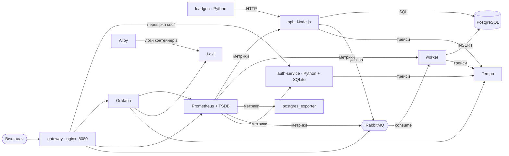

**TagShop Video** : робочий застосунок: відео з товарними тегами на таймкодах (Node.js API + PostgreSQL).
У межах лабораторної імплементовано генерацію даних, збір метрик, логів і трейсів, авторизацію,
обмін повідомленнями та запуск усього в Docker.

## Запуск

Docker Desktop: вільні порти `8080`, `4000`, `5433`.

```bash
docker compose up -d --build                     
docker compose run --rm loadgen python check.py   # автоматична перевірка всіх вимог
```

Очікуваний результат `check.py`: `Пройдено 25/25 перевірок`, з окремим рядком для кожної вимоги.
БД наповнюється автоматично, і через ~1 хв після старту на дашбордах уже є дані.

## Доступ

| Що | Адреса | Логін |
|---|---|---|
| Моніторинг (вхід) | http://localhost:8080 | `admin` / `admin12345` або `viewer` / `viewer12345` |
| Grafana | http://localhost:8080/grafana/ | будь-який із двох |
| Prometheus | http://localhost:8080/prometheus/ | тільки `admin` |
| RabbitMQ | http://localhost:8080/rabbitmq/ | тільки `admin`, далі логін брокера `tagshop` / `tagshop` |
| API застосунку | http://localhost:4000/api | - |

Шляхи на кшталт `/prometheus/targets` відкриваються на http://localhost:8080 після входу як `admin`.

| # | Вимога | Як реалізовано | Як перевірити → що має бути |
|---|---|---|---|
| 0 | СУБД у Docker | PostgreSQL 16, сервіс `postgres` | `docker compose exec postgres psql -U tagshop -c "\dt"` → 8 таблиць |
| 1 | Генерація даних (Python) | `loadgen/seed.py` наповнює БД напряму через psycopg. `loadgen/load.py` безперервно імітує користувачів через API (~5 дій/с) | `docker compose logs seed` → `Seeded 25 users…` (при повторному запуску `Already seeded`). Запит `select count(*) from video_events` росте з кожним виконанням |
| 2 | Збір даних: Prometheus | Метрики з API, worker, PostgreSQL (`postgres_exporter`), RabbitMQ, auth-service, генератора | `/prometheus/targets` → 8 цілей, усі **UP** |
| 3 | Time Series Storage | Вбудована TSDB Prometheus, volume `prometheus_data`, зберігання 15 днів | `/prometheus/tsdb-status` → кількість рядів і chunks |
| 4 | Відображення: Grafana | 5 дашбордів: API, **PostgreSQL**, RabbitMQ, бізнес-метрики, логи | Grafana → Dashboards → папка **TagShop**. Головний: **TagShop · PostgreSQL**: з'єднання, TPS, cache hit, рядки й розмір таблиць, час SQL-запитів |
| 5 | Логи: Loki | JSON-логи всіх сервісів, їх збирає Grafana Alloy | Grafana → Explore → Loki → `{service="api", level=~"warn\|error"} \| json` → рядки 4xx |
| 6 | Трейси: Tempo | OpenTelemetry в API, worker, auth-service; спан на кожен SQL-запит | Grafana → Explore → Tempo → `{resource.service.name="tagshop-worker"}` → один трейс: API → RabbitMQ → worker → `INSERT`. Вкладка Service Graph |
| 7 | Авторизація (Python + SQLite) | `auth-service` (FastAPI + SQLite): користувачі, ролі, журнал входів. nginx пускає до моніторингу лише після перевірки сесії | У приватному вікні http://localhost:8080 → сторінка входу. `viewer` бачить Grafana, а на `/prometheus/` отримує «Доступ заборонено» |
| 8 | Контейнеризація | 14 сервісів в одному `docker-compose.yml` | `docker compose ps` → усі `Up`, `seed` → `Exited (0)` |
| 9 | Обмін повідомленнями: RabbitMQ | API публікує події переглядів і листи в черги `analytics.events` і `email.send`; `worker` записує їх у БД. Невдалі повідомлення потрапляють у `*.dlq` | `/rabbitmq/` → Queues → 4 черги, consumers = 1. `docker compose stop worker` → у `analytics.events` росте Ready; `docker compose start worker` → черга спорожніє |

## Архітектура



## Порти

`ports: "ХОСТ:КОНТЕЙНЕР"` у `docker-compose.yml` відкриває порт контейнера на комп'ютері.
Назовні опубліковано лише чотири порти:

| Хост | → Контейнер | Призначення |
|---|---|---|
| `8080` | `gateway:80` | єдиний вхід у моніторинг (через авторизацію) |
| `4000` | `api:4000` | API застосунку |
| `5433` | `postgres:5432` | БД для інструментів на хості |
| `3000` | `web:3000` | фронтенд, лише з `--profile web` |

Решта портів внутрішні: `prometheus:9090`, `grafana:3000`, `rabbitmq:5672/15672`, `loki:3100`, `tempo:4318`,
`auth-service:8000` тощо. Вони перелічені в `expose:` і доступні тільки іншим контейнерам.
Тому обійти авторизацію не вийде: `curl localhost:9090` → connection refused.

## Структура

```
app-api/        API застосунку + worker (метрики, логи, трейси, RabbitMQ)
loadgen/        Python: seed.py, load.py, check.py
auth-service/   Python: сервер авторизації (FastAPI + SQLite)
gateway/        nginx: вхід у моніторинг
monitoring/     конфіги Prometheus, Grafana (дашборди), Loki, Tempo, Alloy, RabbitMQ
app-web/        фронтенд застосунку
```
